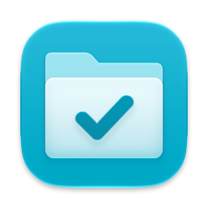
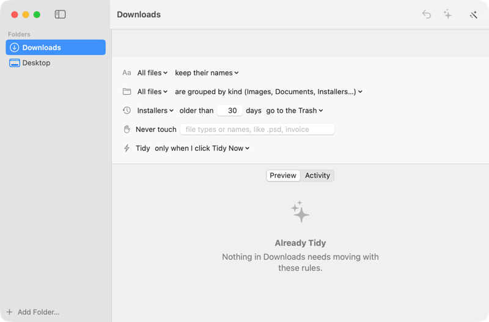

<p align="center"></p>

<h1 align="center">Tidy Up</h1>

<p align="center">Tidies your Downloads and Desktop by simple rules, and can put everything back.</p>

<p align="center"><a href="https://lamp.dev/?repo=https://github.com/lampdotdev/tidyup&amp;from=readme"></a></p>

<p align="center"><a href="#build-it-yourself">Build it yourself</a></p>

<p align="center"></p>

## Make Tidy Up yours

Each opens Lamp with a copy of Tidy Up and that change, ready to send:

- [Write the rules as sticky notes](https://lamp.dev/?repo=https://github.com/lampdotdev/tidyup&from=readme&ask=Write%20the%20rules%20as%20sticky%20notes)
- [Show what's taking up space](https://lamp.dev/?repo=https://github.com/lampdotdev/tidyup&from=readme&ask=Show%20what's%20taking%20up%20space)
- [Sort my photos into albums](https://lamp.dev/?repo=https://github.com/lampdotdev/tidyup&from=readme&ask=Sort%20my%20photos%20into%20albums)

## Open it in Lamp

[Lamp](https://lamp.dev) is a Mac app that builds apps from a description and changes them as you ask. [Open Tidy Up in Lamp](https://lamp.dev/?repo=https://github.com/lampdotdev/tidyup&from=readme) for a copy of your own, to use and to change as you like, with the credits below kept. Or, in Lamp, choose File → Open from GitHub… and paste `https://github.com/lampdotdev/tidyup`.

## Build it yourself

With Apple's Command Line Tools installed (`xcode-select --install`):

```bash
./build.sh
```

The AI inside the app, and anything it does with other apps or devices, goes through Lamp, so those need Lamp open on the same Mac.

## License

MIT. See [LICENSE](LICENSE).
